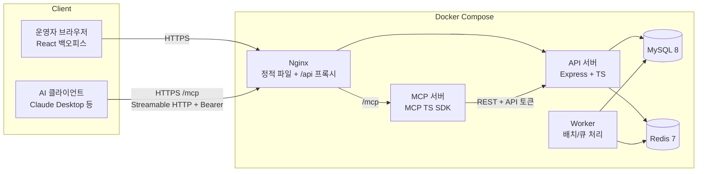
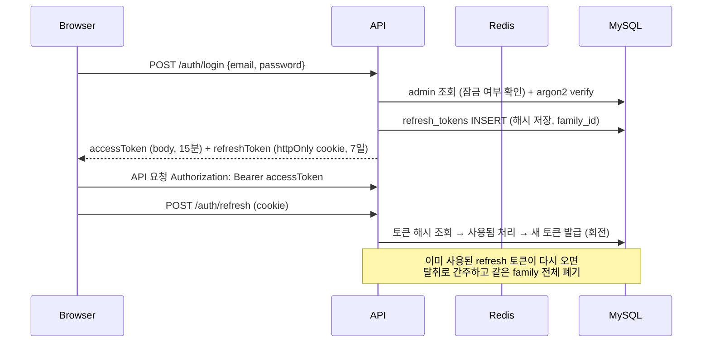

# 시스템 아키텍처

> 상태: **Phase 1 초안 — 검토/승인 대기**
> 포함 내용: 전체 구조 · 기술 선택 근거 · 디렉터리 구조 · 인증/권한 · 보안/예외 처리

---

## 1. 전체 구조



### 1.1 핵심 설계 결정: MCP 서버는 API 서버를 거친다 (D3 승인: A안)

지시서의 두 조건 — "MCP는 DB 직접 접근 금지", "백오피스와 동일한 서비스 계층 사용" — 을 만족하는 방법은 두 가지다.

| 방식 | 설명 | 장점 | 단점 |
|---|---|---|---|
| **A. API 경유 (추천)** | MCP 서버는 얇은 어댑터. 각 Tool이 API 서버의 REST 엔드포인트를 운영자 API 토큰으로 호출 | 인증·권한·검증·감사·중복 방지가 **API 한 곳에서만** 집행됨. MCP 프로세스에 DB 접속 정보가 아예 없음. MCP 서버 탈취 시 피해 범위가 토큰 권한으로 제한 | 네트워크 홉 1회 추가. API 스펙 변경 시 MCP도 수정 |
| B. 서비스 패키지 직접 import | `packages/core`의 Service를 MCP 프로세스에서 직접 호출 | 지연 최소, 코드 재사용 | 결국 MCP 프로세스가 Repository를 통해 DB에 연결 → "DB 직접 접근 금지"의 취지와 충돌. 권한/감사 로직이 두 진입점에 분산될 위험 |

→ **A안으로 확정**했다. "동일한 서비스 계층"은 API 서버 내부의 Service가 WEB/MCP 요청을 모두 처리하는 것으로 충족된다. 요청에는 `X-Channel: MCP` 헤더가 붙고, 감사 로그에 채널이 구분되어 남는다.

> 2026-11-10 변경: Worker 를 별도 패키지(`apps/worker`)에서 `apps/api` 의 두 번째 진입점으로 옮겼다. Worker 작업(정지 해제·KPI·승인 재실행)이 API 와 같은 서비스 계층·DB 접근을 필요로 하는데, 별도 패키지에서는 서비스 코드를 가져올 방법이 없다. 서비스를 `packages/core` 로 분리하는 대안은 현재 규모에 비해 과해 보류.

### 1.2 구성 요소별 책임

| 구성 요소 | 책임 |
|---|---|
| Nginx | 프론트엔드 빌드 결과물 서빙, `/api` 리버스 프록시, 보안 헤더 |
| API 서버 | 인증, 권한, 입력 검증, 비즈니스 로직, 트랜잭션, 감사 로그, 위험 작업 확인 |
| MCP 서버 | Tool 정의, 입력 스키마 검증(1차), API 호출, 결과를 LLM 친화적 텍스트/구조로 변환 |
| Worker | 정지 기간 만료 자동 해제(1분), 시즌 시작·종료(1분), 예약 점검 시작(1분), 일별 KPI 집계(매일 00:10 KST + 기동 시 빠진 날짜 채우기). **API 와 같은 패키지의 두 번째 진입점(`apps/api/src/worker.ts`)** — 같은 서비스 계층을 쓰고 이미지도 같다. 스케줄은 BullMQ Job Scheduler(Redis 저장)라 여러 개 띄워도 한 번씩만 실행 |
| MySQL | 원본 데이터(Source of Truth) — 회원, 재화 원장, 우편, 감사 로그, 랭킹 원본 점수 |
| Redis | 랭킹 Sorted Set, Refresh Token 폐기 목록, 로그인 실패 카운트, Rate Limit, 분산 락, 작업 큐 |

### 1.3 API 서버 내부 계층

```
Request
  → Middleware (requestId, logger, helmet, cors, rateLimit, auth, channel)
  → Router (경로 + 권한 선언: requirePermission('currency:grant'))
  → Controller (zod 검증, DTO 변환, 응답 포맷)
  → Service (비즈니스 규칙, 트랜잭션 경계, 감사 로그, 중복 방지)
  → Repository (Drizzle 쿼리. SQL은 여기에만 존재)
  → MySQL / Redis
```

규칙
- Controller는 Repository를 직접 호출하지 않는다.
- Service는 `req`/`res`를 모른다 → Express 없이 단위 테스트 가능.
- 트랜잭션은 Service에서 시작하고, Repository는 `tx` 객체를 주입받는다.
- 감사 로그는 **변경과 같은 트랜잭션**에서 기록한다(변경은 됐는데 로그가 없는 상황 방지).

---

## 2. 기술 선택 근거

### 2.1 Backend

| 항목 | 선택 | 이유 | 단점/대안 |
|---|---|---|---|
| 런타임 | Node.js 22 LTS | 지시서 지정. 2027년까지 LTS 지원 | — |
| 프레임워크 | Express 5 | 지시서 지정. Express 5는 async 핸들러의 에러를 자동 전파해 래퍼 불필요 | 구조 강제가 없음 → 계층 규칙을 직접 정의 (위 1.3) |
| ORM/쿼리 | **Drizzle ORM** (추천) | TypeScript 스키마 = 타입 원천. SQL에 가까운 API라 `SELECT ... FOR UPDATE`, 조건부 UPDATE 같은 재화 정합성 쿼리를 그대로 표현. drizzle-kit으로 마이그레이션 생성 | 생태계가 Prisma보다 작음 |
| | Prisma (대안) | 학습 자료 풍부, 스키마 DSL이 읽기 쉬움 | 행 잠금(`FOR UPDATE`)을 raw SQL로 써야 함 → 재화 로직의 핵심이 타입 밖으로 빠짐. 별도 엔진 바이너리로 Docker 이미지 증가 |
| | Kysely (대안) | 순수 쿼리 빌더, 타입 추론 우수 | 마이그레이션·스키마 정의를 별도 구성 |
| 검증 | zod | API·Web·MCP가 **같은 스키마 공유**. MCP SDK도 zod로 Tool 입력 스키마를 받음 | — |
| 인증 | **jose** + argon2 (2026-11-10 jsonwebtoken → jose 변경) | jose: ESM·타입 내장·의존성 없음, 알고리즘 고정 검증. argon2id는 현재 권장 비밀번호 해시 | argon2 는 네이티브 모듈 (Windows·Alpine 용 사전 빌드 제공) |
| Redis 클라이언트 | ioredis | 클러스터/센티널 지원, 안정적 | — |
| 로깅 | pino | JSON 구조화 로그, 고성능, 민감 필드 redact 기능 | — |
| 큐 | BullMQ | Redis 기반, 재시도·지연 작업 지원 → 예약 발송 확장 시 그대로 사용 | Redis 의존 증가 |
| 테스트 | Vitest + Supertest + Testcontainers | 실제 MySQL/Redis 컨테이너로 통합 테스트 → 모킹으로 숨겨지는 트랜잭션/락 버그 검출 | 테스트 실행 시 Docker 필요 |

### 2.2 Frontend

| 항목 | 선택 | 이유 | 단점/대안 |
|---|---|---|---|
| 빌드 | Vite | 지시서 지정 | — |
| UI | **Ant Design 5** (추천) | 백오피스용 Table(정렬/필터/페이지네이션), Form, DatePicker, Modal이 완성도 높게 내장. 한국어 로케일 기본 제공 | 번들 크기 큼, 디자인 개성 적음 |
| | MUI (대안) | 커스터마이징 자유도 | DataGrid 고급 기능 일부 유료 |
| | shadcn/ui (대안) | 디자인 자유도, 가벼움 | 테이블·폼을 직접 조립 → 개발 기간 증가 |
| 서버 상태 | TanStack Query | 캐싱, 재시도, 무효화 표준 | — |
| 라우팅 | React Router 7 | 표준, 라우트별 권한 가드 구현 용이 | — |
| 차트 | Recharts | 선언적, 대시보드 수준에 충분 | 대용량 데이터엔 부적합 (대시보드는 집계 데이터라 문제 없음) |
| 폼 | Ant Design Form + zod 스키마 검증 | 서버와 동일 규칙으로 클라이언트 검증 | — |

### 2.3 MCP

| 항목 | 선택 | 이유 |
|---|---|---|
| SDK | `@modelcontextprotocol/sdk` (공식 TS SDK) | 지시서 지정. `McpServer.registerTool` + zod 입력 스키마 |
| Transport | **Streamable HTTP (기본, D4 확정)** + stdio (로컬 개발용) | 원격 AI 클라이언트가 HTTPS로 접속해야 하므로 HTTP가 기본. stdio는 로컬 디버깅·MCP Inspector용으로 같은 Tool 정의를 공유. 세션 상태를 서버에 두지 않는 stateless 모드로 운영해 재시작·확장에 안전 |
| 원격 인증 | **Bearer API 토큰 (D12 확정)** | Claude Code, Cursor, MCP Inspector 등 헤더 지정이 가능한 클라이언트와 바로 연결. OAuth 2.1(MCP 스펙 인증)은 확장 지점만 설계 — claude.ai 웹 커스텀 커넥터 연결이 필요해지면 추가 |
| 버전 | 착수 시점 최신 안정 버전 고정(lockfile) | SDK 변경이 잦아 버전 고정 필수 |

### 2.4 Infrastructure

| 항목 | 선택 | 이유 |
|---|---|---|
| 저장소 구조 | **npm workspaces 모노레포** (D2 확정, 2026-11-06 pnpm → npm 변경) | 공용 zod 스키마/타입 공유, 한 번의 PR로 API·Web·MCP 동시 변경, CI 단일화. Node 기본 도구라 추가 설치 불필요. 단점: 의존성이 루트로 끌어올려져(hoisting) 선언 안 한 패키지도 import 가능(유령 의존성) → ESLint `import/no-extraneous-dependencies`로 보완 예정. 병렬 실행 기능이 없어 `concurrently` 사용 |
| 컨테이너 | Docker multi-stage build | 빌드 도구 제외한 경량 런타임 이미지 |
| 로컬 실행 | Docker Compose (profile: `dev`, `test`) | 원클릭 실행 |
| CI | **GitHub Actions** (D1 확정) | 별도 CI 서버 운영 불필요, PR 상태 체크와 바로 연동, 서비스 컨테이너로 MySQL/Redis 통합 테스트 가능. 단점: 무료 실행 시간 제한, 러너 커스터마이징 제약 |
| 배포 | **AWS EC2 프리티어, 로컬 검증 후 배포** (D6·D11 확정) | 로컬 Compose에서 운영과 같은 구성(`docker-compose.prod.yml`)으로 충분히 검증한 뒤 EC2 1대에 같은 Compose 배포. Actions가 이미지를 GHCR에 푸시 → 수동 승인 후 SSH로 `pull && up`. 제약은 아래 2.5 참고 |
| DB 마이그레이션 | drizzle-kit generate + 마이그레이션 실행기 | 마이그레이션 파일을 Git으로 관리, 컨테이너 시작 전 실행 |

### 2.5 AWS 프리티어 제약과 대응

2025-07-15 이후 생성 계정은 시간 기반 무료가 아니라 **크레딧 기반 Free 플랜(최대 6개월)** 이고, t3.micro/t3.small/t4g.micro/t4g.small 등이 대상이다. 그 이전 계정은 12개월간 t2/t3.micro 월 750시간. → **가입 시점부터 기간이 흐르므로 AWS 계정은 배포 직전에 만드는 것을 권장.**

| 제약 | 영향 | 대응 |
|---|---|---|
| t3.micro 메모리 1GB | MySQL + Redis + API + MCP + Worker + Nginx를 한 대에 올리기 빠듯함 | 신규 계정이면 **t3.small(2GB)** 선택. t3.micro라면 swap 2GB, MySQL `innodb_buffer_pool_size=128M`·`performance_schema=OFF`, Redis `maxmemory 64mb`, Node `--max-old-space-size` 제한, API와 Worker를 한 컨테이너로 합치는 옵션 제공 |
| RDS·ElastiCache 별도 사용 시 크레딧 소모 | 비용 증가 | MySQL·Redis도 같은 VM의 컨테이너로 운영 (데이터는 EBS 볼륨 + 일일 `mysqldump` 백업) |
| 퍼블릭 IPv4 과금 | 크레딧 소모 | 감수 (소액). Elastic IP 1개만 사용 |
| 시드 규모 | 10만 회원·500만 활동 로그는 디스크·메모리 부담 | 운영 데모는 `SEED_SCALE=medium`(1만 회원). 성능 측정(NFR)은 로컬에서 수행 |
| HTTPS 필요 (원격 MCP·쿠키 Secure) | 도메인 필요 | 보유 도메인 또는 무료 DDNS + Let's Encrypt(certbot 컨테이너) |

---

## 3. 프로젝트 디렉터리 구조 (권장)

```
game-admin/
├── apps/
│   ├── api/                      # 백오피스 API 서버
│   │   ├── src/
│   │   │   ├── app.ts            # Express 앱 조립 (테스트에서 import)
│   │   │   ├── bootstrap.ts      # buildServices(서비스 조립) / buildApp(라우터)
│   │   │   ├── server.ts         # API 진입점: listen + graceful shutdown
│   │   │   ├── worker.ts         # Worker 진입점: BullMQ 스케줄 작업
│   │   │   ├── jobs/             # Worker 작업 (KPI 집계 등)
│   │   │   ├── scripts/          # seed, seed-game, simulator
│   │   │   ├── config/           # 환경변수 로드·검증 (zod)
│   │   │   ├── common/
│   │   │   │   ├── errors/       # AppError 계층, 에러 코드
│   │   │   │   ├── middleware/   # auth, requirePermission, requestId, errorHandler, rateLimit
│   │   │   │   ├── http/         # 응답 포맷, 페이지네이션 유틸
│   │   │   │   └── logger.ts
│   │   │   ├── infra/
│   │   │   │   ├── db/           # drizzle client, schema/, migrations/
│   │   │   │   └── redis/        # ioredis client, lock, idempotency
│   │   │   └── modules/          # 기능별 수직 분할
│   │   │       ├── auth/         # *.router.ts / *.controller.ts / *.service.ts / *.repository.ts
│   │   │       ├── admins/
│   │   │       ├── users/
│   │   │       ├── currencies/
│   │   │       ├── mails/
│   │   │       ├── rankings/
│   │   │       ├── audit-logs/
│   │   │       └── dashboard/
│   │   └── test/
│   │       ├── unit/
│   │       └── integration/
│   ├── web/                      # React 백오피스
│   │   └── src/
│   │       ├── app/              # 라우터, Provider, 레이아웃
│   │       ├── features/         # users/, currencies/, mails/ ... (화면 + API 훅)
│   │       ├── shared/           # api client, 권한 가드, 공용 컴포넌트
│   │       └── main.tsx
│   └── mcp/                      # MCP 서버
│       └── src/
│           ├── index.ts          # transport 선택 (stdio/http)
│           ├── server.ts         # McpServer 생성 + Tool 등록
│           ├── tools/            # tool당 1파일
│           └── api-client.ts     # API 서버 호출 (토큰, 재시도, 에러 매핑)
├── packages/
│   ├── shared/                   # zod 스키마, DTO 타입, 에러 코드, 권한 상수
│   ├── tsconfig/                 # 공용 tsconfig
│   └── eslint-config/
├── tools/
│   ├── seed/                     # 시드 데이터 생성
│   └── simulator/                # 가짜 플레이 이벤트 생성기
├── docker/
│   ├── api.Dockerfile
│   ├── web.Dockerfile            # 빌드 후 nginx 이미지
│   ├── mcp.Dockerfile
│   └── nginx/nginx.conf
├── docs/
├── docker-compose.yml
├── docker-compose.test.yml
├── docker-compose.prod.yml       # EC2와 동일 구성 (로컬에서 먼저 검증)
├── .github/workflows/        # ci.yml (PR 검사), deploy.yml (수동 승인 배포)
├── .env.example                  # 실제 값 없음. .env는 .gitignore
└── README.md
```

**모듈 구조를 "계층별(controllers/, services/)"이 아닌 "기능별(modules/users/...)"로 나누는 이유**: 기능 하나를 수정할 때 한 폴더 안에서 끝나고, 모듈 간 의존이 눈에 보인다. 단점은 공용 로직 위치가 애매해질 수 있다는 점 → `common/`, `infra/`로 명확히 분리.

---

## 4. 인증 및 권한 설계

### 4.1 운영자 인증 (WEB)



| 항목 | 설계 | 이유 |
|---|---|---|
| Access Token | JWT, HS256, 15분, 메모리 보관 (localStorage 금지) | XSS로 토큰 탈취 위험 최소화 |
| Refresh Token | 랜덤 256bit 불투명 토큰, httpOnly + Secure + SameSite=Strict 쿠키, DB엔 SHA-256 해시만 저장 | DB 유출 시에도 토큰 재사용 불가 |
| 회전 | 사용 시마다 새 토큰 발급, 재사용 감지 시 family 전체 폐기. 단 10초 이내 재사용은 여러 탭의 동시 갱신으로 보고 거절만 함 | 탈취 토큰 탐지 + 다중 탭 오탐 방지 |
| 로그아웃 | refresh token 폐기 + access token `jti`를 Redis 블랙리스트(남은 만료 시간만큼 TTL). Redis 장애 시 블랙리스트는 건너뛰고 경고 로그 (access token 은 최대 15분 후 만료) | 즉시 무효화 |
| 권한 변경 반영 | JWT엔 `sub`, `role`, `permVersion`만 포함. 권한 변경 시 `permVersion` 증가 → 불일치 시 재발급 요구 | 권한 회수가 최대 15분 지연되는 문제 방지 |
| 잠금 | 5회 실패 → 15분 잠금 (`admins` 테이블 컬럼) | 무차별 대입 방어. Redis 장애와 무관하게 유지 |

### 4.2 MCP 인증 (API 토큰)

- 운영자가 백오피스에서 **개인 API 토큰**을 발급: 이름, 허용 권한(본인 권한의 부분집합), 만료일(최대 90일).
- 토큰 형식 `ga_<prefix>_<secret>` — DB엔 prefix와 secret의 해시만 저장, 원문은 발급 시 1회만 표시.
- MCP 서버는 환경변수 `GAME_ADMIN_API_TOKEN`으로 토큰을 받아 `Authorization: Bearer`로 API 호출.
- API는 토큰 → 소유 운영자 → (운영자 권한 ∩ 토큰 권한)으로 실제 권한 계산. **MCP라고 권한이 더 넓어지지 않는다.**
- 감사 로그에는 운영자 ID + 토큰 ID + 채널(MCP)이 남는다.

### 4.2.1 원격 MCP 보안 ⚠️

원격 MCP는 인터넷에 노출된 쓰기 가능 엔드포인트이므로 별도로 경고한다.

| 항목 | 설계 |
|---|---|
| 전송 | HTTPS 전용 (Nginx에서 TLS 종료, HTTP는 리다이렉트) |
| 인증 | 요청마다 `Authorization: Bearer ga_...` — MCP 서버는 토큰을 **저장하지 않고** 해당 요청의 API 호출에만 사용. 원격 모드에선 서버 전역 토큰(환경변수)을 쓰지 않음 |
| 토큰 용도 제한 | API 토큰에 `audience = mcp` 속성 → MCP 경유 요청에서만 유효, 웹 로그인 세션 대용으로 못 씀 |
| 토큰 검증 비용 | API가 토큰 해시 조회 결과를 Redis에 30초 캐시, 폐기 시 캐시 즉시 삭제 |
| Origin 검증 | MCP 스펙 권고대로 `Origin` 헤더 화이트리스트 검사 (DNS rebinding 방지) |
| Rate Limit | 토큰당 분당 60회, 변경 Tool은 분당 10회 |
| 접근 제한 (선택) | Nginx에서 `/mcp`를 특정 IP 대역만 허용하는 옵션 |
| 로그 | 모든 Tool 호출을 토큰 ID와 함께 기록 (조회 Tool 포함 — 감사 로그와 별도 접근 로그) |
| OAuth 확장 지점 | 인증 처리를 `authProvider` 인터페이스 뒤에 두어, 나중에 OAuth 2.1 Resource Server(토큰 검증 + `/.well-known/oauth-protected-resource`)로 교체 가능하게 설계 |

### 4.3 RBAC + 운영자별 Override

**권한(Permission) 목록** — `리소스:행위` 형식

| 권한 | 설명 |
|---|---|
| `dashboard:read` | 대시보드 조회 |
| `user:read` | 회원 목록/상세/활동 이력 |
| `user:read_pii` | 개인정보 마스킹 해제 열람 |
| `user:suspend` | 회원 정지/해제 |
| `currency:read` | 재화 잔액/이력 조회 |
| `currency:grant` | 재화 지급 |
| `currency:deduct` | 재화 회수 |
| `mail:read` | 우편 이력 조회 |
| `mail:send` | 개별 우편 발송 |
| `mail:send_all` | 전체 우편 발송 |
| `ranking:read` | 랭킹 조회 |
| `ranking:manage` | 랭킹 갱신/초기화 |
| `audit:read` | 운영 로그 조회 |
| `admin:manage` | 운영자 계정·역할·권한 관리 |
| `token:manage_own` | 본인 API 토큰 관리 |

**기본 역할** `[가정]`

| 역할 | 주요 권한 |
|---|---|
| `SUPER_ADMIN` | 전체 |
| `OPERATOR` (운영자) | 조회 전체 + `user:suspend`, `currency:grant/deduct`, `mail:send`, `ranking:read`, `token:manage_own` |
| `CS` (고객지원) | `user:read`, `currency:read`, `mail:read`, `mail:send`, `audit:read`(본인 작업) |
| `VIEWER` | 조회 권한만 (`*:read`, `user:read_pii` 제외) |

**실효 권한 계산**: `역할 권한 ∪ 개인 추가(GRANT) − 개인 제외(DENY)` — DENY가 항상 우선.
권한 검사는 서버에서만 신뢰한다. 프론트엔드의 메뉴 숨김은 UX일 뿐 보안 수단이 아니다.

**자기 권한 상승 방지**: `admin:manage` 보유자도 자기 자신의 역할/권한은 변경 불가, `SUPER_ADMIN` 부여는 `SUPER_ADMIN`만 가능.

### 4.4 위험 작업 확인 절차 (D5: 확인 토큰 — 2026-11-16 4-eyes 승인 제거)

위험도 분류

| 등급 | 대상 | 처리 |
|---|---|---|
| L0 조회 | 모든 read | 바로 실행 |
| L1 변경 | 개별 우편, 상한 이하 재화 지급, 회원 정지/해제 | 바로 실행 (WEB: 확인 모달 / MCP: 아래 확인 토큰) |
| L2 위험 | 재화 회수, 상한 초과 지급, 영구 정지 | **확인 토큰 2단계** 필수 |
| L3 고위험 | 전체 우편 발송, 랭킹 초기화·스냅샷 복원·순위 보상, 대량(100명↑) 지급 | **웹 전용** 확인 토큰 2단계 + 빨간 경고 화면(대상 수·총량). MCP 토큰은 미리보기만 받고 403 `CHANNEL_NOT_ALLOWED` |

**확인 토큰 2단계 (L2, MCP/WEB 공통)**

1. 실행 요청에 `dryRun: true` (또는 MCP에서 첫 호출) → API가 실행 없이 **미리보기**(대상, 변경 전/후 잔액, 영향 범위)와 `confirmationToken`(5분 유효, 요청 내용 해시에 바인딩)을 반환.
2. 같은 요청 + `confirmationToken`으로 재호출 → 내용이 달라졌으면 거부, 같으면 실행.

→ LLM이 사용자에게 미리보기를 보여주고 확인을 받은 뒤 실행하게 되는 구조. 요청 내용 해시에 묶여 있어 확인 후 수량을 바꿔치기할 수 없다.

**L3 (웹 전용 강한 확인)**: 흐름은 L2 와 같지만 ① 미리보기가 대상 인원·재화 총량·되돌리기 방법을 담은 빨간 경고 화면이고 ② **WEB 채널에서만 토큰을 발급**한다. MCP(API 토큰)로 호출하면 실행 없이 미리보기만 담아 403 — AI 가 혼자 대규모 작업을 실행할 수 없고, 사람이 웹에서 확인해야 한다.

> 2026-11-16 변경: 처음엔 L3 를 "다른 운영자 승인(4-eyes)"으로 구현했으나(승인함·`approval_requests`·Worker 재시도), 1인 운영 포트폴리오에서 매번 다른 계정으로 승인하는 흐름이 불편해 사용자 결정으로 제거. 대신 웹 전용 + 강한 확인으로 바꿨다. 트레이드오프: 한 사람이 실수로 대규모 작업을 실행하는 것은 막지 못한다(확인 화면 2번과 사유·감사 로그로 완화). 운영 조직에서는 4-eyes 를 다시 두는 편이 안전하다.

MCP 클라이언트가 Elicitation(서버가 사용자에게 직접 확인 요청)을 지원하면 L2 확인에 활용할 수 있지만, 클라이언트 지원 편차가 있어 **확인 토큰 방식을 기본**으로 하고 Elicitation은 보조로 둔다.

---

## 5. 보안 설계

| 위협 | 대응 |
|---|---|
| SQL Injection | Drizzle 파라미터 바인딩만 사용, raw SQL은 Repository 내 `sql` 템플릿(자동 바인딩)만 허용, 린트로 문자열 결합 쿼리 금지 |
| XSS | React 기본 이스케이프, `dangerouslySetInnerHTML` 금지(린트), 우편 본문은 평문 저장, CSP 헤더 |
| CSRF | Refresh 쿠키는 SameSite=Strict + `/auth/refresh`에 커스텀 헤더 요구. 나머지 API는 Bearer 토큰이라 CSRF 비대상 |
| 무차별 대입 | 로그인 잠금, IP별 Rate Limit(Redis) |
| 권한 우회(IDOR) | 모든 변경 라우트에 `requirePermission` 선언 필수 — 미선언 라우트가 있으면 테스트에서 실패하도록 라우트 메타데이터 검사 |
| 비밀값 노출 | `.env`는 gitignore, `.env.example`만 커밋, 시작 시 zod로 환경변수 검증(누락 시 기동 실패), pino redact로 `password`, `token`, `authorization` 로그 마스킹 |
| 개인정보 | 목록·상세 기본 마스킹(`ab***@example.com`), `user:read_pii` 보유 시만 원문 + 열람 로그 |
| 재화 남용 | 1회 지급 상한, 운영자별 일일 지급 한도(Redis 카운터), 상한 초과는 확인 토큰(L2), 100명↑ 대량 지급은 웹 전용 L3 |
| 감사 로그 변조 | Append-only (UPDATE/DELETE API 없음). 앱용 DB 계정에 `audit_logs` DELETE 권한 미부여 `[가정]` |
| 보안 헤더 | helmet (HSTS, X-Content-Type-Options, frame-ancestors 'none') |
| 의존성 취약점 | CI에서 `npm audit --omit=dev` (High 이상 실패) |

### 5.1 MCP 특화 위험 ⚠️

| 위험 | 설명 | 대응 |
|---|---|---|
| 프롬프트 인젝션 | 회원 닉네임, 우편 본문 같은 **게임 데이터 안에 LLM 지시문**이 섞여 있으면 AI가 의도치 않은 Tool을 호출할 수 있음 | ① 위험 작업은 확인 필수, 대규모 작업(L3)은 MCP 로 실행 불가 ② Tool 응답에서 사용자 입력 필드를 명확히 데이터로 구분(JSON 구조 반환) ③ 토큰 권한 최소화 |
| 과도한 권한 위임 | AI에게 SUPER_ADMIN 토큰을 주면 사고 범위가 무제한 | 토큰 권한을 본인 권한의 부분집합으로 제한, 기본 발급 템플릿은 조회 전용 |
| 반복 호출 | LLM 재시도로 같은 지급이 여러 번 실행 | 모든 변경 Tool에 Idempotency Key 필수 (mcp-tools.md) |
| 토큰 유출 | MCP 설정 파일에 평문 저장 | 만료일 강제, 즉시 폐기 기능, 토큰별 마지막 사용 시각·IP 표시 |

---

## 6. 중복 실행 방지 설계

이중 방어: **Redis 락(빠른 거절) + MySQL 유니크 제약(최종 보장)**

```
1. 클라이언트가 Idempotency-Key(UUID) 헤더 전송 (WEB: 폼 열 때 생성 / MCP: Tool 입력값)
2. Redis SET idem:{adminId}:{key} "IN_PROGRESS" NX EX 60
   - 실패 → 이미 처리 중: 409 REQUEST_IN_PROGRESS
3. idempotency_keys 테이블 조회
   - 같은 키 + 같은 요청 해시 → 저장된 응답 그대로 반환 (재실행 없음)
   - 같은 키 + 다른 요청 해시 → 422 IDEMPOTENCY_KEY_REUSED
4. 트랜잭션 안에서: 업무 처리 + 감사 로그 + idempotency_keys INSERT(유니크)
5. 커밋 후 Redis 키를 응답 캐시로 갱신 (TTL 24h)
```

Redis가 죽어도 4번의 유니크 제약 때문에 중복 반영은 일어나지 않는다(동시 요청 중 하나는 유니크 위반으로 롤백).

---

## 7. 예외 처리 설계

### 7.1 에러 계층

```ts
class AppError extends Error { code: ErrorCode; status: number; details?: unknown; expose: boolean }
```

| 클래스 | HTTP | 예시 코드 |
|---|---|---|
| ValidationError | 400 | `VALIDATION_FAILED` |
| UnauthorizedError | 401 | `AUTH_REQUIRED`, `TOKEN_EXPIRED`, `INVALID_CREDENTIALS` |
| ForbiddenError | 403 | `PERMISSION_DENIED`, `SELF_APPROVAL_NOT_ALLOWED` |
| NotFoundError | 404 | `USER_NOT_FOUND`, `MAIL_NOT_FOUND` |
| ConflictError | 409 | `REQUEST_IN_PROGRESS`, `ALREADY_SUSPENDED`, `APPROVAL_ALREADY_PROCESSED` |
| BusinessRuleError | 422 | `INSUFFICIENT_BALANCE`, `EXCEEDS_GRANT_LIMIT`, `CONFIRMATION_REQUIRED`, `CONFIRMATION_MISMATCH`, `IDEMPOTENCY_KEY_REUSED` |
| AccountLockedError | 423 | `ACCOUNT_LOCKED` |
| RateLimitError | 429 | `RATE_LIMITED` |
| ServiceUnavailableError | 503 | `RANKING_UNAVAILABLE` (Redis 장애) |
| (그 외 모든 예외) | 500 | `INTERNAL_ERROR` — 메시지 숨김, requestId만 노출 |

### 7.2 원칙

- 에러는 **한 곳(errorHandler 미들웨어)** 에서만 응답으로 변환한다. Service에서 `res.status()` 금지.
- 예상된 에러(AppError)는 `warn`, 예상 못한 에러는 `error` + 스택으로 로그. 응답엔 스택을 절대 포함하지 않는다.
- DB 에러 매핑: `ER_DUP_ENTRY` → Conflict, 데드락(`ER_LOCK_DEADLOCK`) → **최대 2회 자동 재시도** 후 실패.
- `catch` 후 무시 금지 — 삼켜야 하는 경우 주석으로 이유 명시 + 로그(지시서 "임시방편으로 오류를 숨기지 않는다").
- MCP 서버는 API 에러 코드를 받아 `isError: true` + 사람이 읽을 수 있는 메시지 + 에러 코드로 반환 → LLM이 원인을 이해하고 사용자에게 설명 가능.

### 7.3 장애 시나리오

| 상황 | 동작 |
|---|---|
| Redis 다운 | 랭킹 API 503, 중복 방지는 DB 유니크로 계속 보장, Rate Limit은 fail-open(로그 경고) — 로그인 잠금은 DB 기반 fallback `[가정]` |
| MySQL 다운 | `/health/ready` 실패 → 503, 진행 중 트랜잭션 롤백 |
| 전체 우편 발송 중 Worker 중단 | 우편 자체는 1건(GLOBAL)으로 저장되므로 부분 발송 상태가 생기지 않음 (database.md 4.3) |
| 종료 신호(SIGTERM) | 신규 요청 차단 → 진행 중 요청 완료 대기(최대 10초) → DB/Redis 연결 종료 |

---

## 8. 관측성

- 모든 요청에 `X-Request-Id` 생성/전파 (MCP → API 호출에도 전달), 로그·감사 로그·에러 응답에 포함.
- `/health/live` (프로세스), `/health/ready` (DB·Redis 연결).
- 로그 필드: `time, level, requestId, adminId, channel, method, path, status, durationMs`.
