# 데이터베이스 설계

> 상태: **Phase 1 초안 — 검토/승인 대기**
> MySQL 8.0 / InnoDB / utf8mb4 (`utf8mb4_0900_ai_ci`) / 모든 시각은 **UTC 저장**, 화면에서 KST 변환

## 1. 설계 원칙

| 원칙 | 내용 |
|---|---|
| 단일 스키마 `[결정 필요 D7]` | `game_admin` 하나에 게임 데이터와 백오피스 데이터를 두되, 테이블 접두어 없이 도메인별로 구분. 실제 서비스라면 게임 DB와 운영 DB를 분리하겠지만, 포트폴리오 범위에선 트랜잭션 단순성이 더 중요 |
| PK | `BIGINT UNSIGNED AUTO_INCREMENT` (내부), 외부 노출용 회원 ID는 `public_id`(문자열) 별도 |
| 금액/수량 | `BIGINT` 정수 (소수 재화 없음) |
| 상태값 | `VARCHAR` + 애플리케이션 enum (MySQL ENUM은 값 추가 시 ALTER 필요해서 지양) |
| 삭제 | 운영자·회원은 soft delete/비활성화. 원장·감사 로그는 절대 삭제하지 않음 |
| 변경 추적 | 모든 테이블 `created_at`, 변경되는 테이블 `updated_at` |
| 낙관적 잠금 | `user_currencies.version` (조건부 UPDATE 검증용) |
| FK | 원장·감사 로그 같은 대용량 append 테이블엔 FK를 걸지 않고 인덱스만 (쓰기 성능, 파티셔닝 대비). 마스터/관계 테이블엔 FK 적용 |

## 2. ERD

```mermaid
erDiagram
    %% ===== 운영자/권한 =====
    admins ||--o{ admin_permission_overrides : has
    roles ||--o{ admins : assigned
    roles ||--o{ role_permissions : has
    permissions ||--o{ role_permissions : in
    permissions ||--o{ admin_permission_overrides : in
    admins ||--o{ refresh_tokens : owns
    admins ||--o{ api_tokens : owns

    %% ===== 회원/게임 =====
    users ||--o{ user_suspensions : has
    users ||--o{ user_currencies : holds
    currencies ||--o{ user_currencies : of
    users ||--o{ currency_transactions : ledger
    users ||--o{ user_items : holds
    items ||--o{ user_items : of
    users ||--o{ user_activity_logs : generates

    %% ===== 우편 =====
    mails ||--o{ mail_rewards : contains
    mails ||--o{ mail_recipients : "USER 대상"
    mails ||--o{ global_mail_claims : "GLOBAL 수령"
    users ||--o{ mail_recipients : receives

    %% ===== 랭킹 =====
    ranking_seasons ||--o{ ranking_scores : has
    ranking_seasons ||--o{ ranking_snapshots : archived
    ranking_snapshots ||--o| ranking_reward_payouts : rewarded

    %% ===== 운영 =====
    admins ||--o{ audit_logs : performs

    admins {
        bigint id PK
        varchar email UK
        varchar password_hash
        varchar name
        bigint role_id FK
        varchar status "ACTIVE|DISABLED"
        int perm_version
        boolean must_change_password
        int failed_login_count
        datetime locked_until
        datetime last_login_at
    }
    roles { bigint id PK
        varchar code UK
        varchar name }
    permissions { bigint id PK
        varchar code UK "currency:grant"
        varchar description }
    role_permissions { bigint role_id PK
        bigint permission_id PK }
    admin_permission_overrides { bigint admin_id PK
        bigint permission_id PK
        varchar effect "GRANT|DENY" }
    refresh_tokens { bigint id PK
        bigint admin_id FK
        char token_hash UK
        char family_id
        datetime expires_at
        datetime used_at
        datetime revoked_at }
    api_tokens { bigint id PK
        bigint admin_id FK
        varchar prefix UK
        char secret_hash
        json permissions
        datetime expires_at
        datetime last_used_at
        datetime revoked_at }

    users { bigint id PK
        varchar public_id UK
        varchar nickname
        varchar email
        int level
        varchar status "ACTIVE|SUSPENDED|WITHDRAWN"
        datetime registered_at
        datetime last_login_at }
    user_suspensions { bigint id PK
        bigint user_id FK
        varchar reason
        datetime starts_at
        datetime ends_at "NULL=영구"
        bigint suspended_by
        datetime released_at
        bigint released_by
        varchar release_reason }
    currencies { int id PK
        varchar code UK "GOLD|GEM|STAMINA|FREE_GEM"
        boolean is_paid
        bigint max_balance
        bigint grant_limit_per_request }
    user_currencies { bigint user_id PK
        int currency_id PK
        bigint balance
        int version }
    currency_transactions { bigint id PK
        bigint user_id
        int currency_id
        bigint delta
        bigint balance_before
        bigint balance_after
        varchar source "ADMIN|MAIL|GAME"
        varchar reason
        bigint admin_id
        varchar channel
        bigint mail_id
        varchar request_id
        datetime created_at }
    items { int id PK
        varchar code UK
        varchar name
        boolean stackable }
    user_items { bigint user_id PK
        int item_id PK
        bigint quantity }
    user_activity_logs { bigint id PK
        bigint user_id
        varchar type
        json payload
        datetime occurred_at }

    mails { bigint id PK
        varchar type "USER|GLOBAL"
        varchar title
        text body
        varchar status "SCHEDULED|SENT|CANCELED"
        datetime scheduled_at
        datetime sent_at
        datetime expires_at
        json target_filter
        bigint created_by
        varchar reason }
    mail_rewards { bigint id PK
        bigint mail_id FK
        varchar reward_type "CURRENCY|ITEM"
        int ref_id
        bigint quantity }
    mail_recipients { bigint mail_id PK
        bigint user_id PK
        datetime read_at
        datetime claimed_at }
    global_mail_claims { bigint mail_id PK
        bigint user_id PK
        datetime claimed_at }

    ranking_seasons { int id PK
        varchar name
        varchar status "ACTIVE|ENDED"
        datetime starts_at
        datetime ends_at
        int reset_count }
    ranking_scores { int season_id PK
        bigint user_id PK
        bigint score
        datetime achieved_at
        bigint achieved_seq }
    ranking_snapshots { bigint id PK
        int season_id
        char snapshot_id
        int rank_no
        bigint user_id
        bigint score
        varchar kind
        varchar reason
        datetime created_at }
    ranking_reward_payouts { bigint id PK
        int season_id
        char snapshot_id UK
        json tiers
        json mail_ids
        int recipient_count
        int skipped_count
        bigint created_by
        datetime created_at }

    audit_logs { bigint id PK
        bigint admin_id
        bigint api_token_id
        varchar channel "WEB|MCP|SYSTEM"
        varchar action
        varchar target_type
        varchar target_id
        varchar reason
        json before_data
        json after_data
        varchar result "SUCCESS|FAILURE"
        varchar error_code
        varchar request_id
        varchar ip
        datetime created_at }
    idempotency_keys { bigint id PK
        bigint admin_id
        varchar idem_key
        char request_hash
        int response_status
        json response_body
        datetime created_at }
    daily_kpis { date stat_date PK
        int dau
        int nru
        int suspended_total }
    daily_currency_stats { date stat_date PK
        int currency_id PK
        bigint issued
        bigint consumed }
```



## 3. 주요 인덱스

| 테이블 | 인덱스 | 용도 |
|---|---|---|
| users | `UK(public_id)`, `IDX(nickname)`, `IDX(status, registered_at)`, `IDX(last_login_at)` | 정확 검색, 닉네임 접두어 검색(`LIKE 'abc%'`), 상태+기간 필터, DAU |
| user_suspensions | `IDX(user_id, created_at)`, `IDX(released_at, ends_at)` | 회원별 이력, 만료 자동 해제 배치 |
| currency_transactions | `IDX(user_id, created_at)`, `IDX(admin_id, created_at)`, `IDX(created_at, currency_id)` | 회원별/운영자별 이력, 일별 집계 |
| user_activity_logs | `IDX(user_id, occurred_at)`, `IDX(type, occurred_at)` | 회원별 이력, DAU 집계 |
| mail_recipients | `IDX(user_id, claimed_at)` | 회원별 우편함 |
| ranking_scores | `IDX(season_id, score DESC, achieved_at)` | Redis 재구성 시 정렬 조회 |
| audit_logs | `IDX(admin_id, created_at)`, `IDX(target_type, target_id, created_at)`, `IDX(action, created_at)`, `IDX(created_at)` | 필터 조합 |
| idempotency_keys | `UK(admin_id, idem_key)` | **중복 실행 최종 방어** |
| refresh_tokens | `UK(token_hash)`, `IDX(family_id)` | 회전, family 폐기 |

**대용량 대비 (설계만, 이번 범위에선 미적용)**: `user_activity_logs`, `audit_logs`, `currency_transactions`는 월 단위 RANGE 파티셔닝 후보. 그래서 이 테이블들엔 FK를 걸지 않는다(MySQL 파티션 테이블은 FK 미지원).

## 4. 핵심 데이터 흐름

### 4.1 재화 지급/회수 (트랜잭션)

```sql
BEGIN;
-- 1) 행 잠금 (동시 지급·회수 직렬화)
SELECT balance, version FROM user_currencies
 WHERE user_id = ? AND currency_id = ? FOR UPDATE;      -- 행이 없으면 balance=0으로 INSERT
-- 2) 애플리케이션 검증: 회수 시 balance >= amount, 지급 시 balance + amount <= max_balance
UPDATE user_currencies SET balance = ?, version = version + 1
 WHERE user_id = ? AND currency_id = ?;
INSERT INTO currency_transactions (... balance_before, balance_after, reason, admin_id, channel, request_id ...);
INSERT INTO audit_logs (... action='CURRENCY_GRANT', before_data, after_data ...);
INSERT INTO idempotency_keys (admin_id, idem_key, request_hash, response_status, response_body);  -- 유니크
COMMIT;
```

- 잔액(`user_currencies`)은 원장(`currency_transactions`)의 캐시 역할. 정합성 검증 쿼리(`SUM(delta) = balance`)를 테스트와 운영 점검용으로 제공.
- 여러 재화를 한 번에 바꿀 땐 `currency_id` 오름차순으로 잠금 → 데드락 방지.

### 4.2 회원 정지

- `users.status = 'SUSPENDED'` + `user_suspensions` INSERT를 같은 트랜잭션에서 처리.
- 기간 만료 → Worker가 1분 주기로 `ends_at <= now() AND released_at IS NULL` 조회 후 해제(채널 `SYSTEM`으로 감사 로그).
- 이미 정지 중인 회원 재정지 → `409 ALREADY_SUSPENDED` (기간 연장은 해제 후 재정지, 또는 S 우선순위로 "기간 변경" 별도 기능).

### 4.3 우편 — 개별 vs 전체 발송

| 유형 | 저장 방식 | 이유 |
|---|---|---|
| USER (개별, ≤1,000명) | `mails` 1건 + `mail_recipients` N건 (배치 INSERT, 같은 트랜잭션) | 수신자별 읽음/수령 상태 추적 |
| GLOBAL (전체) | `mails` 1건 + `target_filter`(예: `registered_before`) 저장. 수신자 행을 미리 만들지 않음. 수령 시 `global_mail_claims`에 기록 | 회원 수만큼 INSERT하는 fan-out은 수십만 행 쓰기 → 락·지연·부분 실패 위험. 실제 게임에서 흔히 쓰는 방식 |

수령(시뮬레이터가 호출): 보상 지급(재화 원장 `source=MAIL`) + `claimed_at` 갱신을 한 트랜잭션에서. `claimed_at IS NULL` 조건부 UPDATE로 중복 수령 방지.

예약 발송 확장 지점: `status='SCHEDULED'`, `scheduled_at` 컬럼을 미리 두고, 지금은 `SENT`로만 생성. 확장 시 BullMQ 지연 작업이 상태를 `SENT`로 전환.

### 4.4 랭킹

**순위 기준: ① 점수 높은 순 ② 같은 점수면 먼저 기록한 순**

**저장**
- 원본: `ranking_scores` (MySQL) — 시즌·회원별 최고 점수, 달성 시각, `achieved_seq`(기록 순서 번호)
- 조회: Redis ZSET `rank:v2:season:{id}` (점수 = 원점수, 멤버 = `<16자리 (10^15 − seq)>:<userId>`) + 해시 `rank:v2:season:{id}:members` (userId → 현재 멤버)
  - Redis 는 같은 점수의 멤버를 바이트 순서로 정렬, `ZREVRANGE` 는 큰 멤버부터 → seq 가 작을수록 상위
  - seq 는 유일 → 3순위 기준 불필요, userId 체계(샤딩·스노플레이크·UUID)와 무관

**기록 순서 번호 (2026-11-10 변경: DB 카운터 → 시간 기반)**
- `seq = (2020-01-01 부터 경과 ms) × 1000 + 서버번호(0~9) × 100 + 순번(0~99)` — 앱에서 발급 (`seq-generator.ts`)
- 중앙 카운터가 없어 잠금 경합 없음. 같은 서버에서는 항상 증가(시계가 뒤로 가도), 서버 간에는 ms 단위 비교
- 서버 번호는 `RANKING_NODE_ID` (API 를 여러 대 띄우면 서버마다 다르게)
- 이전 방식(시즌 행 `score_seq` 를 `LAST_INSERT_ID` 로 증가)은 시즌의 모든 점수 기록이 한 행을 잠가 **핫 로우**가 됨 — 잠금 시간에 Redis 왕복까지 포함되어 시즌당 초당 수백 건이 상한이었음

**점수 기록 (`recordScore`)**
1. 순서 번호 발급 (잠금 없음)
2. 트랜잭션: 회원 행만 `FOR UPDATE` → 더 높을 때만 저장 (같은 회원의 동시 갱신만 직렬화). 첫 점수 동시 INSERT 로 유니크 충돌 시 1회 재시도
3. **커밋 후** Redis 반영 — Lua 스크립트로 원자적으로: ZSET 이 없으면 생략 / 해시에서 예전 멤버를 찾아 **새 점수가 더 높을 때만** 교체. 같은 회원의 갱신이 순서가 뒤바뀌어 도착해도 최고 점수가 남음
4. Redis 실패 시 점수 저장은 성공으로 두고 해당 시즌 키를 삭제 → 다음 조회 때 MySQL 에서 재적재

**재구성 (`rebuild`, 지연 적재, Worker 10분 주기 `ranking-reconcile`)**
1. 따라잡기 기준 번호 = 지금 −30초 의 seq
2. MySQL 을 keyset 으로 읽어 임시 ZSET·해시에 적재 → `MULTI(RENAME, RENAME)` 로 원자 교체 (조회 중단 없음)
3. **따라잡기**: 기준 번호 이후 기록을 다시 읽어 Lua 로 반영 — 적재 중 커밋된 점수 누락 방지 (반복 적용해도 결과 동일)
4. 상한을 넘는 점수가 있으면 잘라 넣지 않고 실패

**초기화 (`reset`, L3 웹 전용 확인)**: `ROW_NUMBER() OVER (ORDER BY score DESC, achieved_seq ASC)` 스냅샷 → 원본 삭제 → Redis 키·해시 삭제 → `reset_count + 1` 을 한 트랜잭션에서

**일관성 정리**
| 상황 | 결과 |
|---|---|
| Redis 반영 실패 | 키 삭제 → 다음 조회 시 재적재. 삭제도 실패하면 Worker 10분 재구성으로 복구 |
| 적재 중 기록 | 따라잡기로 반영 |
| 같은 회원 동시 갱신 | DB: 행 잠금으로 최고 점수, Redis: Lua 점수 비교로 최고 점수 |
| 서버 간 시계 오차 | 같은 점수일 때 그 오차(보통 수 ms) 범위에서 순서가 바뀔 수 있음 — 허용 |

## 5. Redis 키 설계

| 키 | 타입 | TTL | 용도 |
|---|---|---|---|
| `rank:v2:season:{id}` | ZSET | 없음 | 랭킹 (점수 = 원점수, 멤버 = 기록순서+userId) |
| `rank:v2:season:{id}:members` | HASH | 없음 | userId → 현재 멤버 (예전 멤버 제거용) |
| `rank:loading:{id}` | STRING | 60초 | ZSET 지연 적재 중복 방지 락 |
| `auth:jti:blacklist:{jti}` | STRING | access 남은 수명 | 로그아웃된 access token |
| `idem:{adminId}:{key}` | STRING(JSON) | 60초(처리 중) / 24시간(완료) | 중복 실행 1차 방어 |
| `confirm:{token}` | STRING(payload hash) | 5분 | 확인 토큰 |
| `rl:{scope}:{id}` | STRING(counter) | 윈도우 | Rate Limit |
| `limit:grant:{adminId}:{yyyymmdd}:{currency}` | STRING(counter) | 25시간 | 운영자 일일 지급 한도 |
| `game:maintenance-state` | STRING(JSON) | 30초 | 지금·다음 점검 + 세션 세대 (게임 API 차단 판단, 변경 시 즉시 삭제. 장애 시 DB 로 판단) |
| `bull:*` | — | — | BullMQ 큐 |

모든 키는 환경별 접두어(`ga:{env}:`)를 붙인다.

> 로그인 실패 횟수·잠금은 Redis 가 아니라 `admins.failed_login_count`, `admins.locked_until` 에 저장한다 (2026-11-10 변경). Redis 장애 시에도 잠금이 유지되고, 운영자 수가 적어 DB 부하가 없다.

## 6. 시드 데이터 `[가정]`

| 대상 | 규모 |
|---|---|
| 운영자 | 역할별 1~2명 (비밀번호는 `.env`의 `SEED_ADMIN_PASSWORD`로 주입, 코드에 없음) |
| 회원 | 100,000명 (닉네임은 랜덤 생성, 실제 개인정보 아님. 이메일은 `@example.com`) |
| 활동 이력 | 최근 60일, 약 500만 건 |
| 재화 원장 | 회원당 평균 20건 |
| 랭킹 | 시즌 2개(종료 1, 진행 1) |

성능 목표(requirements.md NFR) 검증용이며, `SEED_SCALE=small` 옵션으로 개발 시엔 1,000명 규모로 빠르게 생성.


### 랭킹 스냅샷 복원·순위 보상 (2026-11-11 추가)

- `ranking_snapshots.kind`: `RESET`(초기화 직전) / `BACKUP`(스냅샷 복원 직전 자동 보관). 복원은 BACKUP 을 다시 복원하는 방식으로 되돌릴 수 있다.
- 복원(교체): 같은 트랜잭션에서 현재 점수를 BACKUP 스냅샷으로 복사 → `ranking_scores` 삭제 → 스냅샷을 `ranking_scores` 로 복사 → Redis 키 삭제(다음 조회 때 재적재).
  복사할 때 `achieved_at` = 스냅샷 시각, `achieved_seq` = `seqFromTime(스냅샷 시각) + rank_no` → 스냅샷 순위(동점 순서 포함)가 그대로 재현되고, 복원 뒤 같은 점수를 새로 낸 회원은 아래에 선다.
- `ranking_reward_payouts`: 스냅샷 순위 보상 지급 기록. `snapshot_id` UNIQUE 로 같은 스냅샷 중복 지급을 DB 가 최종 차단(확인 화면 전에도 지급 기록을 미리 확인). 구간마다 개별 우편 1통(`mail_ids`), 탈퇴 회원 제외 인원은 `skipped_count`.


### 스케줄·이미지 (2026-11-15 추가) — docs/schedule.md

- `schedules`: 랭킹 시즌·게임 이벤트 일정과 게임 노출 설정. 상태(예정·진행·종료)는 저장하지 않고 시각으로 계산, 취소만 `canceled_at`. `version` 으로 낙관적 잠금. 시즌은 `ranking_season_id` UNIQUE 로 1:1
- `assets`: 업로드 이미지. 파일은 저장소(로컬 → S3), 테이블엔 판별된 형식·크기·sha256(중복 업로드 재사용). `storage_key` 는 UUID
- `ranking_seasons.status`: `SCHEDULED → ACTIVE → ENDED` (+ 시작 전 취소 `CANCELED`). 워커 `season-lifecycle`(1분)이 조건부 UPDATE 로 전환 → 여러 워커여도 한 번
- `ranking_snapshots.kind = FINAL`: 시즌 종료 시 자동 저장되는 최종 순위 (점수는 지우지 않음). 순위 보상 지급 가능
- 점수 기록은 진행 중 시즌·기간 안에서만 (`SEASON_NOT_ACTIVE`)
- 시즌 겹침 검사는 MySQL 이름 잠금(GET_LOCK)으로 직렬화. 잠금은 별도 연결에서 잡고 **커밋 후** 해제

- `ranking_boards` (2026-11-15): 랭킹 종류(아레나·월드아레나). `ranking_seasons.board_id` 기본값 1(아레나). FK 는 걸지 않고 애플리케이션에서 검증(기존 시즌 행이 보드 테이블보다 먼저 존재하는 마이그레이션 순서 때문). 시즌 겹침은 보드마다

### 점검·공지 (2026-11-15 추가) — docs/maintenance-notice.md

- `maintenances`: 게임 점검. 상태(예정·진행·종료·취소)는 시각으로 계산 (`ended_at` = 지금 열기, `canceled_at` = 취소). `allow_public_ids` JSON(≤100) 예외 회원. 기간 겹침 검사·시작 처리는 이름 잠금 `game-admin:maintenance` 로 직렬화
- 세션 세대: 시작 처리 때 `session_epoch = MAX(session_epoch) + 1` 을 조건부 UPDATE(`started_at IS NULL`)로 한 번만 기록. 현재 세대 = 최댓값 (별도 테이블 없음). 워커 `maintenance-lifecycle`(1분) + 시작 시각 뒤 첫 게임 요청이 처리
- `notices`: 공지 목록 + 로비 한 줄 공지. `ends_at` NULL = 계속 게시, `hidden_at` = 내림, `maintenance_id` = 점검 공지(점검 시간 변경 시 문구·기간 동기화). 본문은 평문 그대로 저장

### 승인 기능 제거 (2026-11-16)

- `approval_requests` 테이블, `ranking_reward_payouts.approval_request_id` 컬럼, `approval:review` 권한 삭제 (마이그레이션 + 시드가 남은 권한·역할 연결·개별 부여를 정리)
- 지난 승인 이력은 `audit_logs`(APPROVAL_* 작업)에 그대로 남는다


### 유저 분석 (2026-11-18 추가) — docs/analytics.md

- `users.max_stage`: 최고 클리어 스테이지 (STAGE_CLEAR 로 `greatest()` 갱신). 이탈·과금 구간 기준
- `products`: 가상 결제 상품 (id 고정, 시드)
- `purchases`: 결제 기록 — append only, FK 없음. 결제 당시 가격·젬·스테이지를 그대로 남김. `IDX(purchased_at)`, `IDX(user_id, purchased_at)`
- `currency_transactions.source` 에 `PURCHASE` 추가 (결제로 받은 유료 젬)
- 시드: 순서대로 진행 + 난이도 벽 모델. 기간 이전은 상태만 계산하고 잔액을 "이전 기록 이월" 1건으로 남김 (원장 합계 = 잔액)
